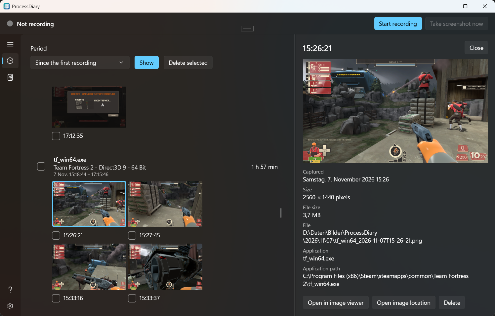
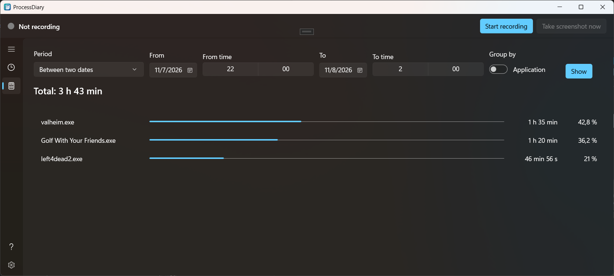

# ProcessDiary

ProcessDiary is a Windows 11 desktop app that builds a visual diary of your computer activity: screenshots plus the applications you used, organized into a browsable timeline.

It is a transparent journaling tool, not a surveillance tool.

View your recoreded sessions and screenshots:


View your total duration per program:


## Principles

- **User-controlled** – you decide when recording starts, pauses, and what is deleted.
- **Local-first** – all data is stored on your computer. Nothing is sent over the network.
- **Transparent** – recording status is always visible. There is no hidden mode.
- **Privacy-respecting** – no keystroke logging, no password or clipboard capture, no undocumented telemetry.

## Features

- Periodic screenshots of your activity
- Application sessions (which application was in the foreground, and for how long)
- Timeline view of your diary
- Pause, resume, and delete recorded data at any time

## Technology

MSI installer (WiX)
- .NET 10
- SQLite for local storage
- CommunityToolkit.Mvvm, Microsoft.Extensions.Hosting / DependencyInjection / Logging, NLog

## Solution Structure

| Project | Layer | Purpose |
| --- | --- | --- |
| `ProcessDiary` | UI | WinUI 3 views and view models |
| `ProcessDiary.Application` | Application | Use cases, services, commands, DTOs |
| `ProcessDiary.Domain` | Domain | Entities, business rules, interfaces |
| `ProcessDiary.Infrastructure` | Infrastructure | SQLite, Windows APIs, screenshot capture, process detection |
| `ProcessDiary.Installer` | Installer | WiX project that builds the MSI |
| `ProcessDiary.Tests` | Tests | Unit and integration tests |

The Domain layer has no dependency on WinUI, and Win32 code is isolated behind interfaces in Infrastructure.

## Getting Started

### Prerequisites

- Windows 11
- Visual Studio 2026 with the WinUI / Windows App SDK workload
- .NET 10 SDK

### Build and Run

1. Clone the repository.
2. Open `ProcessDiary.slnx` in Visual Studio.
3. Set `ProcessDiary` as the startup project.
4. Build and run (F5).

### Run Tests

```powershell
dotnet test
```

### Build the Installer (MSI)

The installer packages the published app, so publish it first. Building `ProcessDiary.Installer` without published files only produces warnings (WIX8601, ICE71) and an empty MSI. Run from the repository root:

```powershell
msbuild ProcessDiary/ProcessDiary.csproj /t:Restore,Publish /p:Configuration=Release /p:Platform=x64 /p:RuntimeIdentifier=win-x64 /p:WindowsPackageType=None /p:EnableMsixTooling=false /p:PublishProfile= /p:PublishDir="$PWD\artifacts\publish\"
dotnet build ProcessDiary.Installer/ProcessDiary.Installer.wixproj -c Release -p:Platform=x64
```

The MSI is written to `ProcessDiary.Installer\bin\x64\Release`. Use `ARM64` / `win-arm64` for ARM64. Release builds are created by the "Create Release Draft" GitHub workflow.

## Privacy

ProcessDiary stores data locally only. It never logs keystrokes, captures passwords or clipboard contents, or runs hidden. Screenshot contents are never written to logs.

## License

See [LICENSE.txt](LICENSE.txt).
